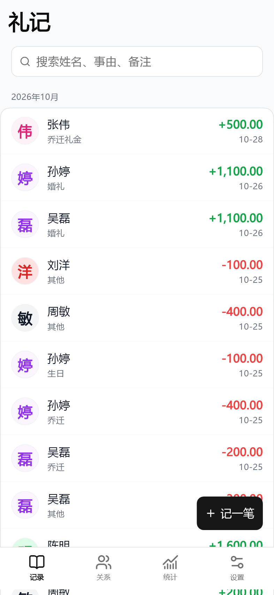
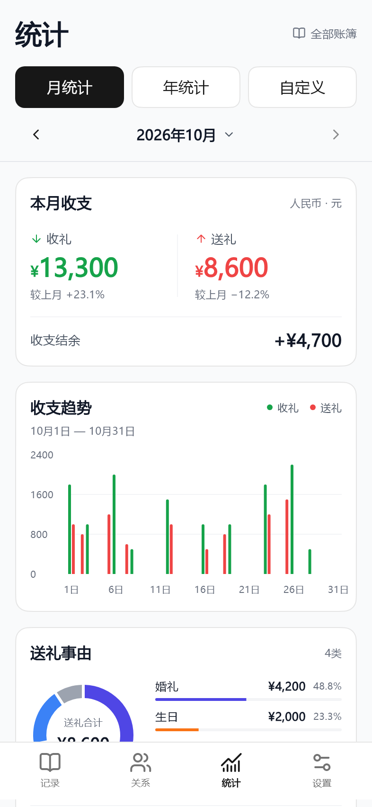
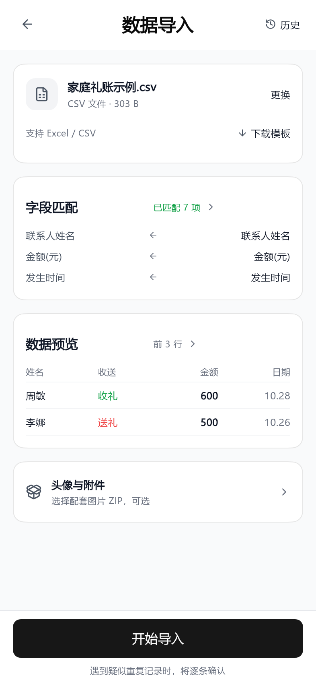
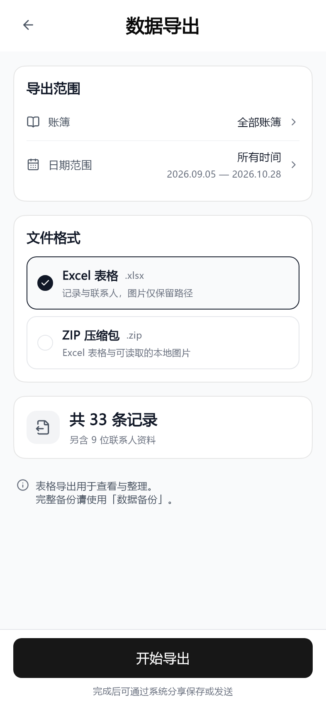
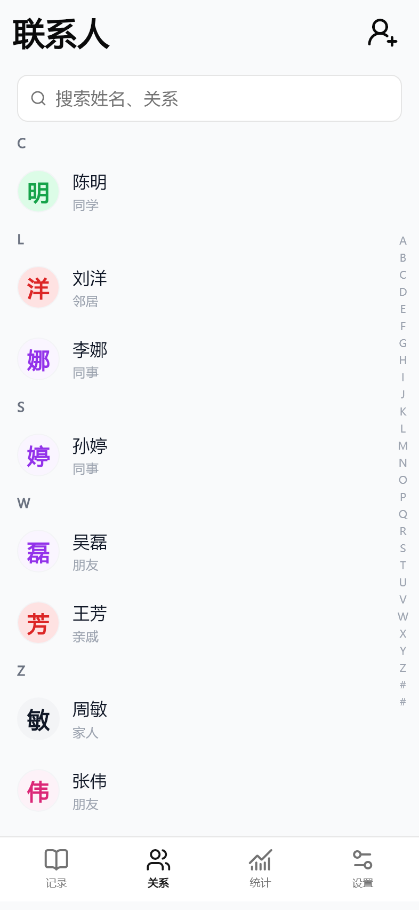
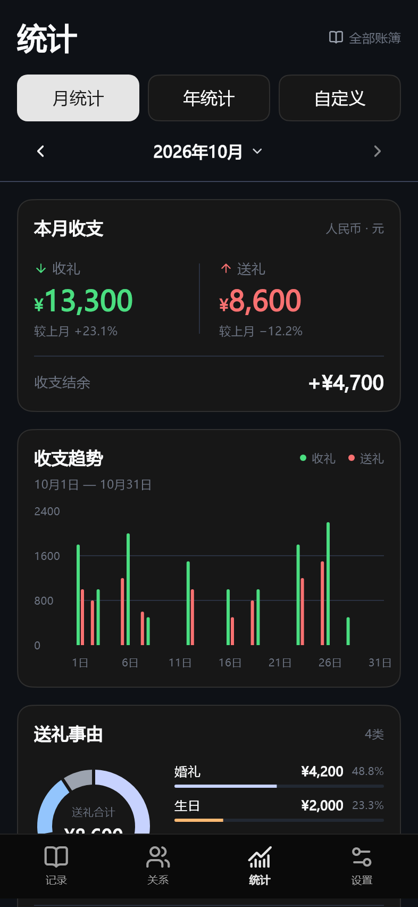

<div align="center">


# 礼记

**把每一笔往来记清楚。**

一款本地优先的 Android 礼账应用，记录收礼、送礼和联系人往来。

[下载 1.2.4](https://github.com/ztlgc/NewShangli/releases/tag/1.2.4) · [更新说明](docs/releases/1.2.4.md) · [功能与截图](#界面预览) · [开发指南](#本地开发)

</div>

## 用礼记记录什么

婚礼的礼金、乔迁时的祝福、朋友生日的随礼，或者日常与亲友之间的往来，都可以放进独立的礼账里。打开联系人详情，就能看到与这个人的收礼、送礼、差额和历史记录。

核心数据保存在本机 SQLite 数据库中，无需注册账号。支持本地完整备份，也可以配置自己的 WebDAV 保存整包备份。

## 界面预览

以下图片使用 **9 位虚构联系人、33 条示例记录**，由当前 Flutter 应用页面直接渲染，不包含用户数据。点击图片可查看原图。

<table>
  <tr><th>收送礼记录</th><th>金额与记录编辑</th><th>联系人往来</th></tr>
  <tr>
    <td><a href="docs/screenshots/records.png"></a></td>
    <td><a href="docs/screenshots/record-edit.png"></a></td>
    <td><a href="docs/screenshots/contact-detail.png"></a></td>
  </tr>
  <tr><th>收支统计</th><th>表格导入</th><th>数据导出</th></tr>
  <tr>
    <td><a href="docs/screenshots/statistics.png"></a></td>
    <td><a href="docs/screenshots/data-import.png"></a></td>
    <td><a href="docs/screenshots/data-export.png"></a></td>
  </tr>
</table>

<details>
<summary>查看更多：账簿、联系人列表与深色模式</summary>

<table>
  <tr><th>独立账簿</th><th>联系人列表</th><th>深色模式</th></tr>
  <tr>
    <td><a href="docs/screenshots/account-books.png"></a></td>
    <td><a href="docs/screenshots/contacts.png"></a></td>
    <td><a href="docs/screenshots/statistics-dark.png"></a></td>
  </tr>
</table>

</details>

## 主要功能

| 功能 | 可以做什么 |
| --- | --- |
| 收礼与送礼 | 记录金额、联系人、事由、日期、备注和图片；使用快捷金额快速填写。新增联系人后，自动返回原表单并选中。 |
| 多账簿 | 按婚礼、乔迁、生日等场景分别建账，查看账簿明细；从账簿新增时自动沿用该账簿的事由和日期。 |
| 联系人 | 按姓名、关系搜索，使用拼音索引定位；在详情中查看双方往来、金额合计及差额。联系人全局共享。 |
| 统计分析 | 按月、年或自定义时段汇总全部账簿，查看收支概览、同期对比、双柱趋势、送礼事由及往来排行。 |
| 农历日期 | 日期格同时显示公历与农历，包含节日和节气；日历高度随月份实际行数调整。 |
| 常用事由 | 新建数据库预置 12 项常用事由；可以新增、编辑、停用或删除。 |
| 导入与导出 | 导入 Excel / CSV，核对字段并预览前 20 行；支持疑似重复记录确认、任务暂停和断点继续。导出可选账簿、日期范围及 Excel / ZIP。 |
| 账簿 PDF | 在账簿详情导出 A4 礼账明细，包含序号、名字、金额、备注，支持多页及系统分享。 |
| 备份与恢复 | 本地完整备份与恢复、自定义 WebDAV 整包备份；备份包含数据库及媒体文件。 |
| 编辑保护与回收站 | 使用本地密码保护敏感修改；回收站支持搜索与分组查看，左滑恢复或删除单条内容，也可批量管理。 |

默认事由：结婚礼金、生日礼金、寿宴礼金、满月礼金、百日礼金、周岁礼金、乔迁礼金、升学礼金、开业礼金、节日礼金、探病慰问、丧事慰问。

## 下载与使用

1. 在 [GitHub Releases](https://github.com/ztlgc/NewShangli/releases/tag/1.2.4) 下载 `Liji_1.2.4_arm64.apk`。
2. 在 Android 手机上允许当前下载来源安装应用，然后完成安装。
3. 打开礼记，添加联系人和收送礼记录；也可在「设置 → 账簿管理」创建独立账簿。
4. 定期在「设置 → 数据备份」保存完整备份。

当前安装包支持 **Android 7.0 及以上、ARM64**。版本对应的签名、校验值和验证结果见 [1.2.4 更新说明](docs/releases/1.2.4.md)。发布附件提供 `SHA256SUMS.txt`，Windows 上可以核对下载文件：

```powershell
Get-FileHash .\Liji_1.2.4_arm64.apk -Algorithm SHA256
```

### 数据使用说明

- Excel 导出适合查看、整理；ZIP 导出可携带可读取的本地头像和附件。完整恢复请使用「数据备份」生成的备份包。
- 默认账簿沿用日常往来汇总口径，包含其他账簿的送礼记录；导出页面会说明所选范围。
- WebDAV 保存完整备份包，不执行多设备双向同步。自动备份后台调度尚未实现。
- 当前数据库结构为 schema 15，仅支持当前结构，不提供历史数据库结构升级。备份恢复也只接受兼容的当前结构。
- APK 沿用项目现有调试证书签署 Release 包；尚未完成 Android 真机安装验收。当前以 Android 为主要目标，未提供已验证的鸿蒙版本。

## 本地开发

### 环境

- Flutter stable，Dart **3.13.0 或以上**。本版使用 Flutter 3.47.5 / Dart 3.13.4 构建。
- Android SDK、JDK 和可用的 Android 设备或模拟器。
- 核心技术：Flutter、Forui、Drift / SQLite；图表使用 fl_chart，日期使用 lunar。

```bash
flutter pub get
flutter run
```

项目不需要配置账号或云服务即可启动。历史 `supabase/` 目录已停用，不参与应用运行和打包。

### 检查与构建

```bash
flutter test --no-pub
flutter analyze --no-pub --no-fatal-infos
flutter build apk --split-per-abi --target-platform android-arm64 --release
```

Android 构建产物：`build/app/outputs/flutter-apk/app-arm64-v8a-release.apk`。当前 Gradle Release 配置沿用调试证书；如需更换分发证书，请在自己的构建环境中配置，勿提交密钥或密码。

修改 Drift 表或 DAO 定义后，重新生成代码：

```bash
dart run build_runner build --delete-conflicting-outputs
```

### 重新渲染文档截图

渲染脚本只创建内存数据库和临时示例文件，不打开正式账簿。Windows 示例：

```powershell
$env:UPDATE_FORUI_PREVIEWS = 'true'
$env:FORUI_PREVIEW_FONT = 'C:\Windows\Fonts\msyh.ttc'
$env:README_SCREENSHOTS_DIR = Join-Path (Get-Location) 'docs/screenshots'
flutter test --no-pub test/documentation/readme_screenshots_test.dart
```

中文字体仅用于本地截图，不打包进应用。示例统计数据使用 2026 年 10 月；跨月重新渲染时请同步调整脚本中的日期和统计预览数据。截图用于展示实际页面，不代表真机安装、系统选文件或分享流程已经验收。

### 目录

```text
lib/
  data/local/drift/   数据表、DAO 与数据库初始化
  ui/                页面、Forui 主题与共享组件
  stats/             统计计算与查询
  import/            Excel / CSV 导入、字段映射与任务
  export/            Excel / ZIP / 账簿 PDF 导出
  backup/            本地与 WebDAV 备份恢复
  platform/          文件选择、系统分享和应用目录适配
  media/             头像与附件存储
test/                单元测试、页面测试、文档截图工具和示例数据
tool/                应用图标工具
docs/                设计规范、功能说明、截图与版本记录
```

## 进一步了解

- [统一设计与交互规范](DESIGN_SPEC.md)
- [统计页说明与验证](docs/STATS_PAGE_REDESIGN.md)
- [导入导出说明与验证](docs/DATA_TRANSFER_UI.md)
- [版本记录](docs/releases/)
- [反馈问题](https://github.com/ztlgc/NewShangli/issues)

## 许可证

本项目采用 [MIT License](LICENSE)。使用、修改或分发时请保留原许可证及版权声明。
