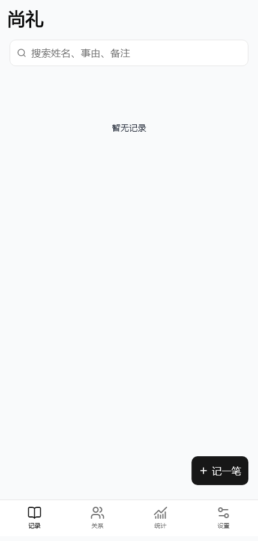
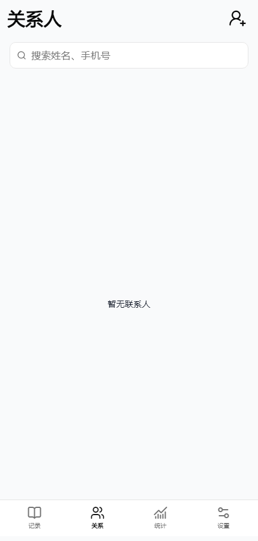
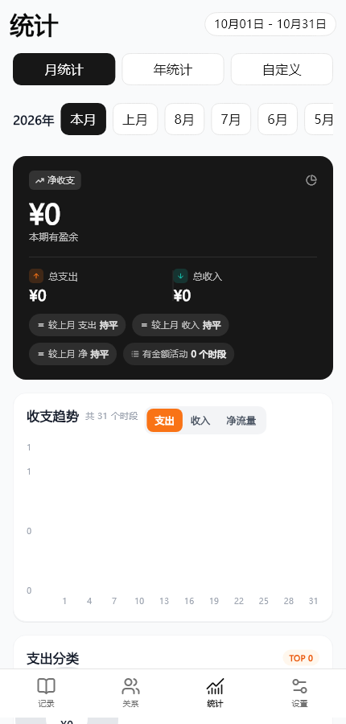
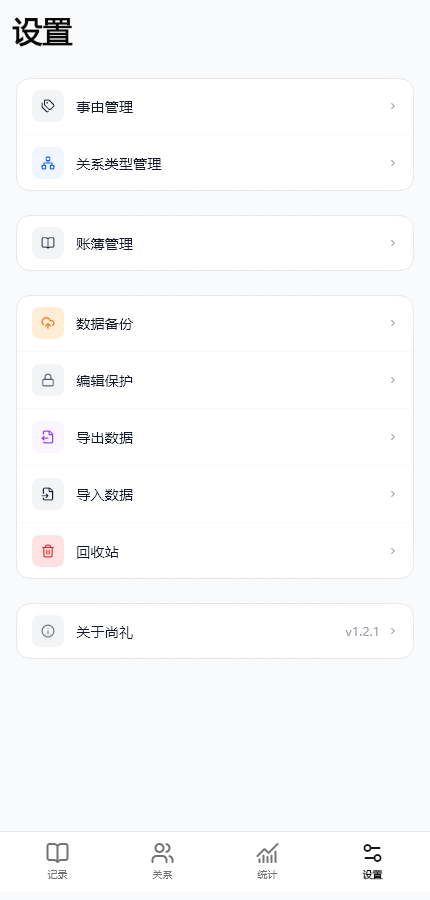

# Forui 页面预览

这里保存当前 Forui 实现的自动化视觉快照。浅色预览覆盖当前 23 个业务页面，视口为 430 × 900；`dark/` 覆盖四个一级页面的深色模式。测试数据来自隔离的内存数据库和临时目录，不会读取或修改用户数据。

## 四个一级页面

| 记录 | 关系人 | 统计 | 设置 |
| --- | --- | --- | --- |
|  |  |  |  |

深色模式：[记录](dark/record.png)、[关系人](dark/people.png)、[统计](dark/stats.png)、[设置](dark/settings.png)。

## 记录、关系人与账簿

- [新增记录](record-add.png)、[记录详情缺失态](record-detail-missing.png)
- [新增关系人](person-edit.png)、[关系人详情](person-detail.png)、[联系人关系编辑](contact-relation-edit.png)
- [账簿管理](account-books.png)、[账簿编辑](account-book-edit.png)、[账簿详情](account-book-detail.png)、[账簿记录](account-book-records.png)、[账簿数据导入](account-book-data-import.png)

## 设置与数据

- [事由管理](reason-manage.png)、[新增事由](reason-detail-create.png)
- [关系类型管理](relation-type-manage.png)、[关系类型详情](relation-type-detail.png)
- [编辑保护](edit-protection.png)、[回收站](recycle-bin.png)
- [数据导入](data-import.png)、[数据导出](data-export.png)、[数据备份](data-backup.png)
旧的 cloud-sync、user-login、user-profile 图像仅作为历史参考，页面与功能已移除，不属于当前 23 页。

这些图像用于评审布局、层级、配色和组件一致性。自动快照与 Widget 测试不能替代 Android 真机上的键盘、安全区和触控检查。

## 重建预览

预览加载应用图标字体，同时要求显式指定一份可读的中文字体，避免 Flutter 测试默认 Ahem 字体把文字和图标显示成方框。字体只用于测试，不打包到应用。本机示例使用微软雅黑；这不是 Android 字体排版的真机验证。

```powershell
$env:UPDATE_FORUI_PREVIEWS = 'true'
$env:FORUI_PREVIEW_FONT = 'C:\Windows\Fonts\msyh.ttc'
flutter test --no-pub --update-goldens --concurrency=1 test/ui/forui_main_tabs_test.dart test/ui/forui_secondary_pages_responsive_test.dart
```
